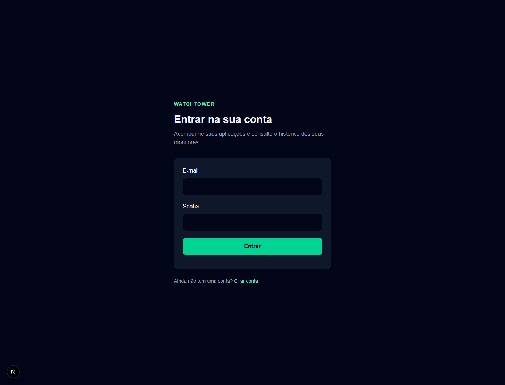
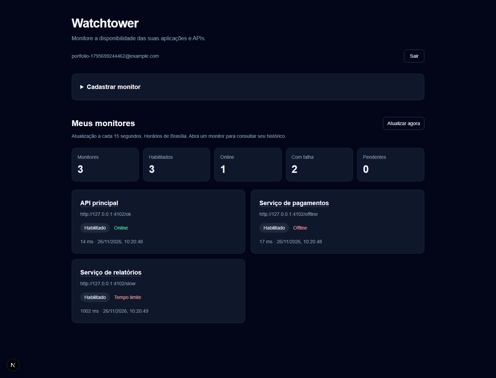
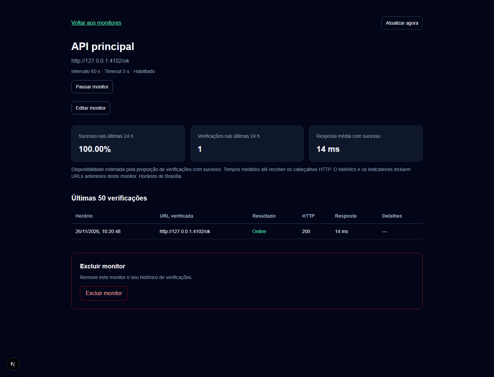
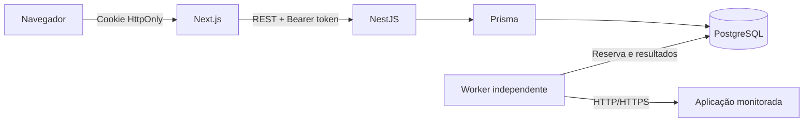

# Watchtower

[](https://github.com/RamonCanabarro/Watchtower/actions/workflows/ci.yml)

Plataforma fullstack para monitorar aplicações e APIs HTTP. Cada usuário gerencia seus próprios monitores, acompanha falhas e consulta o histórico das verificações. Um worker independente mantém o monitoramento ativo enquanto o navegador está fechado.

Projeto de portfólio focado em TypeScript, arquitetura de backend, persistência, concorrência, autenticação e testes de integração.

## Demonstração

As capturas abaixo mostram a aplicação em execução com contas de demonstração e alvos HTTP locais controlados para produzir sucesso, erro 503 e timeout. Os resultados foram registrados pelo worker.

### Acesso à conta



### Dashboard



### Histórico e indicadores



## Funcionalidades

- Cadastro de conta, login e logout com sessões revogáveis.
- Monitores isolados por usuário em todas as consultas e alterações.
- Cadastro e edição de nome, URL, intervalo e timeout.
- Pausa, habilitação e exclusão com confirmação e limpeza do histórico.
- Worker HTTP com timeout total, redirecionamentos limitados e validação de destinos.
- Reservas no PostgreSQL para coordenar workers concorrentes.
- Histórico com URL verificada, status HTTP, duração e motivo da falha.
- Indicadores das últimas 24 horas e atualização da tela a cada 15 segundos.
- CI com PostgreSQL temporário, testes, lint e builds.

## Stack

| Camada | Tecnologias |
| --- | --- |
| Frontend | Next.js 16, React 19, TypeScript, Tailwind CSS 4 |
| Backend | NestJS 12, class-validator, class-transformer |
| Persistência | PostgreSQL 17, Prisma 7.10, adapter-pg e pg |
| Autenticação | scrypt do Node.js, sessões opacas e cookies HttpOnly |
| Testes | Vitest, Supertest e bancos temporários de integração |
| Ambiente | pnpm workspaces, Docker Compose, GitHub Actions |

## Arquitetura



O Next.js renderiza os dados no servidor e usa Server Actions para enviar alterações à API. As regras de negócio e o controle de propriedade ficam no NestJS. O worker reutiliza o Prisma Client e o código de verificação da API em um processo separado.

```text
apps/
  api/
    prisma/             Schema e migrações
    scripts/            Atribuição dos monitores antigos
    src/auth/           Contas, sessões e limitação de tentativas
    src/monitors/       Endpoints e regras de propriedade
    src/monitoring/     Verificações HTTP e agendamento
    test/               Integração com PostgreSQL
  web/
    src/app/            Páginas e Server Actions
    src/components/     Formulários e componentes
  worker/               Comando de execução do worker
infra/                  PostgreSQL local
docs/images/            Capturas reais da interface
.github/workflows/      Integração contínua
```

## Executar localmente

Pré-requisitos: Node.js 26.13.0, pnpm 10.0.0 e Docker com suporte a containers Linux. No Windows, o desenvolvimento pode ser feito pelo Debian WSL com a integração do Docker Desktop habilitada.

Na raiz do projeto:

```bash
pnpm install --frozen-lockfile
cp -n infra/.env.example infra/.env
cp -n apps/api/.env.example apps/api/.env
cp -n apps/web/.env.example apps/web/.env.local
```

Defina a senha do PostgreSQL em `infra/.env` e a mesma senha na `DATABASE_URL` de `apps/api/.env`. Codifique caracteres reservados na senha da URL. Os arquivos de configuração local são ignorados pelo Git.

```bash
docker compose --env-file infra/.env -f infra/compose.yaml up -d --wait
pnpm --filter api db:deploy
pnpm --filter api prisma:generate
pnpm --filter api build
```

Abra três terminais na raiz do projeto:

```bash
# Terminal 1 — API em http://localhost:3001
pnpm --filter api start:dev
```

```bash
# Terminal 2 — processo de verificações
pnpm --filter worker start
```

```bash
# Terminal 3 — dashboard em http://localhost:3000
pnpm --filter web dev
```

Abra http://localhost:3000, crie sua conta e cadastre um monitor. Reinicie o worker após alterações em seu código compilado.

### Preservar monitores de uma instalação anterior

A migração preserva os monitores e seus resultados. Registros sem usuário ficam ocultos e aguardam atribuição. O worker passa a executá-los novamente após receberem um dono.

Depois de criar sua conta, execute localmente, substituindo o e-mail pelo que você cadastrou:

```bash
pnpm --filter api monitors:claim "seu-email@example.com"
```

Esse comando administrativo atribui à conta informada **todos os monitores que ainda estão sem dono**, com seu histórico. Ele pode ser repetido e preserva a propriedade dos monitores que já pertencem a alguma conta. O acesso ao banco local é necessário para executá-lo.

## Decisões técnicas

### Isolamento de dados e sessões

Todos os endpoints de monitores exigem uma sessão válida. O identificador do usuário vem da sessão e é incluído nos filtros de leitura, atualização e exclusão. Um monitor de outro usuário responde com 404.

As senhas têm de 6 a 128 caracteres e são armazenadas com salt aleatório e scrypt (`N=16384`, `r=8`, `p=5`). O formato inclui uma versão para permitir evolução futura. A comparação usa `timingSafeEqual`. Essa combinação de custo está entre as opções recomendadas pela [OWASP](https://cheatsheetseries.owasp.org/cheatsheets/Password_Storage_Cheat_Sheet.html).

Os tokens de sessão são aleatórios, expiram em sete dias e têm somente seu hash SHA-256 armazenado no banco. O navegador recebe o token em cookie `HttpOnly`, `SameSite=Lax` e `Secure` em produção. O logout revoga a sessão atual. Login e cadastro limitam tentativas por origem e e-mail em uma janela de um minuto.

### Concorrência do worker

O worker consulta monitores vencidos a cada segundo e executa até cinco requisições em paralelo. Uma atualização condicional reserva cada monitor por 60 segundos e fornece um token de propriedade. O resultado e o próximo agendamento são gravados na mesma transação, mediante uma reserva válida. Após uma queda do processo, a expiração permite nova execução.

O intervalo é contado a partir da conclusão. Uma edição durante a requisição preserva a reserva e identifica o resultado com a URL original. Uma exclusão remove os resultados em cascata e impede que a requisição em andamento os recrie.

### Resultados e indicadores

HTTP 200–399 conta como sucesso e HTTP 400–599 como indisponibilidade. Timeout e falhas de DNS, conexão ou TLS têm estados próprios. O tempo medido termina ao receber os cabeçalhos e inclui DNS e redirecionamentos.

A disponibilidade é uma estimativa pela proporção de verificações bem-sucedidas nas últimas 24 horas. O histórico é preservado quando a URL muda, e os indicadores incluem as URLs anteriores. Resultados antigos sem `checkedUrl` aparecem como URL não registrada. Horários da interface usam Brasília.

### Destinos HTTP

Destinos privados, loopback, link-local e reservados são bloqueados por padrão. A resolução DNS é validada e usada na conexão. Cada redirecionamento passa pela mesma validação, com limite de cinco saltos e prazo total por verificação.

Para monitorar serviços locais em uma máquina de desenvolvimento de confiança, defina `ALLOW_PRIVATE_TARGETS=true` em `apps/api/.env`.

## Endpoints

| Método | Rota | Ação |
| --- | --- | --- |
| GET | `/health` | Saúde básica da API, público |
| POST | `/auth/register` | Criar conta |
| POST | `/auth/login` | Criar sessão |
| GET | `/auth/me` | Consultar a conta autenticada |
| POST | `/auth/logout` | Revogar sessão atual |
| GET / POST | `/monitors` | Listar ou criar os próprios monitores |
| GET / PUT / DELETE | `/monitors/:id` | Consultar, editar ou excluir um monitor próprio |
| PATCH | `/monitors/:id` | Alterar habilitação |
| GET | `/monitors/:id/checks?limit=50` | Até 100 resultados recentes |
| GET | `/monitors/:id/summary` | Indicadores das últimas 24 horas |

Clientes diretos da API usam `Authorization: Bearer <token>` obtido no login. O frontend gerencia a sessão pelo cookie e encaminha o token no servidor.

## Testes e CI

```bash
bash scripts/verify-mvp.sh
```

O script inicia o PostgreSQL, aplica migrações, gera o client e executa testes, lint e builds. O log fica em `apps/api/.temp/mvp-validation.log`.

```bash
pnpm --filter api test
pnpm --filter api test:e2e
pnpm --filter api test:integration
pnpm --filter api lint
pnpm --filter api build
pnpm --filter web lint
pnpm --filter web build
```

O teste de integração cria e remove um banco temporário exclusivo no servidor de `DATABASE_URL`. O usuário do banco precisa ter permissão de criação de bancos. A suíte cobre persistência, edição e exclusão durante verificações, sessões e tentativas de acesso entre duas contas.

O workflow de CI roda em PRs para `main` e em pushes à `main`, usando PostgreSQL 17 temporário e as versões declaradas de Node e pnpm. O job executa as mesmas verificações sem utilizar as credenciais locais. Para exigir aprovação automática antes do merge, configure o check **Tests, lint and builds** como obrigatório na proteção da branch.

## Estado e próximos avanços

O projeto possui autenticação e isolamento por usuário para demonstração e evolução do produto. A API escuta em `127.0.0.1` por padrão. Em uma publicação, configure HTTPS e a infraestrutura de acesso antes de receber credenciais reais.

Evoluções planejadas incluem verificação de e-mail, recuperação de senha, alertas de queda/recuperação, política de retenção e operação supervisionada dos processos. A limitação de tentativas atual é por processo e deve ser centralizada se a API for distribuída em várias instâncias.
